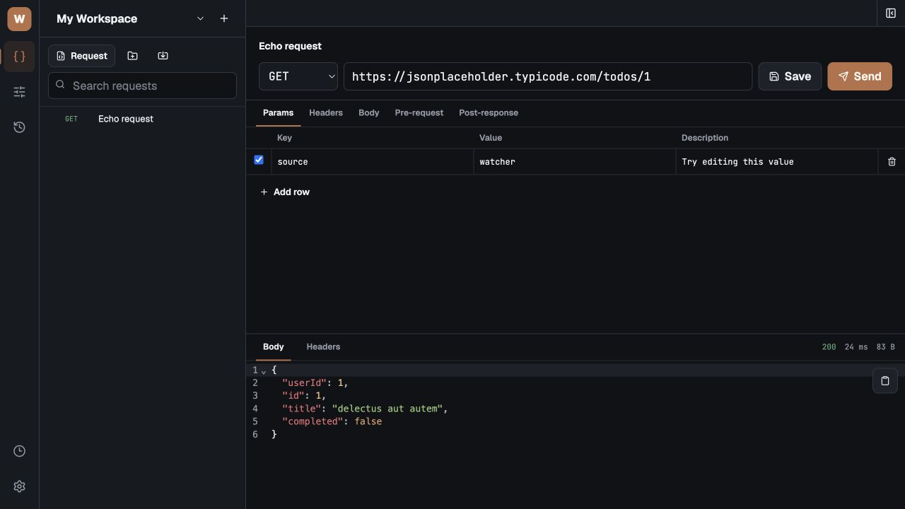

<div align="center">
  
  <h1>Watcher</h1>
  <p>An agent-native, local-first desktop tool for organizing, running, and inspecting APIs.</p>
</div>



## Agent-native API management

Watcher gives people and coding agents the same API-management capabilities. Use the desktop UI, connect an MCP client, or open the built-in assistant popover to manage workspaces, folders, and requests; send one request or a list; and inspect every execution in the same local History.

The built-in MCP server starts with Watcher at:

```text
http://127.0.0.1:11532/mcp
```

It exposes workspace, folder, and request CRUD plus `send_request` and `send_requests`. HTTP executions made through MCP use Watcher's local environment variables and are recorded in History.

The assistant uses assistant-ui with AI SDK v7 and any OpenAI-compatible provider you configure in Settings. If an endpoint returns 401/403, Watcher renders a private credential form inside the tool message. The credential is stored as a local environment value, the saved request sees only a `{{PLACEHOLDER}}`, and the value never enters assistant model context or tool output.

## Why Watcher

Watcher keeps API work on your device. Workspaces, collections, environments, request drafts, tabs, and history are stored in a local SQLite database—there is no account, cloud service, or telemetry.

### Features

- Nested, searchable request collections with keyboard-accessible drag and drop
- Persistent workspaces and request tabs with explicit dirty/save state
- HTTP, HTTPS, headers, query parameters, JSON, text, and form-data bodies
- Local environment variables using `{{ variable }}` substitution
- Constrained pre-request and post-response scripts with a two-second timeout
- Formatted response body, headers, status, timing, size, and copy actions
- Local request history with replay
- Local streamable-HTTP MCP server with traced CRUD and execution tools
- Built-in assistant-ui popover for natural-language API management
- Private credential tool UI with redacted sensitive headers
- Nested Postman Collection and OpenAPI JSON import
- English and Simplified Chinese, with dark, light, and system themes
- Signed in-app updates from GitHub Releases

## Install

Download the installer for Windows, macOS, or Linux from [GitHub Releases](https://github.com/windht/watcher/releases).

Watcher 1.0 uses a new SQLite database and intentionally does not import or delete Watcher 0.9 browser/localForage data.

## Development

### Prerequisites

- Node.js 24
- pnpm 10
- Stable Rust
- [Tauri v2 platform dependencies](https://v2.tauri.app/start/prerequisites/)

```bash
pnpm install
pnpm tauri:dev
```

Useful checks:

```bash
pnpm lint
pnpm typecheck
pnpm test
pnpm build
pnpm tauri:check
```

The browser-only `pnpm dev` mode uses an in-memory demo repository. Packaged and Tauri development builds use SQLite in the platform application-data directory.

## Architecture

- React 19, TypeScript, Vite, React Router 7
- TanStack Query for asynchronous persisted state and Zustand for transient UI state
- shadcn-style components, Radix primitives, Tailwind CSS, dnd-kit, and TanStack Virtual
- React Hook Form and Zod for validated request/environment editing
- CodeMirror 6 for bodies, scripts, and responses
- Tauri v2 with Rust commands and bundled SQLite
- Tauri HTTP, updater, process, and opener plugins

The design source of truth is [`DESIGN.md`](DESIGN.md). It includes the Stitch project, design-system, and primary-screen identifiers used for the Watcher 1.0 redesign.

## Security model

Watcher grants its main Tauri window HTTP and HTTPS access because arbitrary endpoints are the product’s core purpose. Native commands use typed arguments and validate workspace ownership, parent types, tree cycles, and transactional deletion.

Request scripts run in a dedicated Web Worker with no DOM or Tauri API access. The worker is terminated after two seconds and only receives the request, response, environment map, and a small `watcher` API:

```js
watcher.environment.get("token");
watcher.environment.set("token", "new value");
watcher.log(response.status);
```

Do not run scripts from an untrusted collection without reviewing them.
